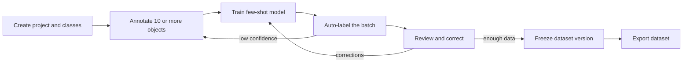

# OpenLabel

[](https://github.com/openlabel/openlabel/actions/workflows/ci.yml)
[](LICENSE)

**A local-first image annotation studio with few-shot auto-labeling.**
Annotate ten examples, train a small model in your browser, label the rest, and
export a dataset — without an account, a server, or an upload.

OpenLabel is an early-stage (0.1.0) open-source project. The workflow is
usable, but the data schema and internal APIs may change before 1.0.

---

## Why

Most annotation tools either run in someone else's cloud or stop at drawing
boxes. OpenLabel brings the familiar Roboflow-style annotate → train →
auto-label → export loop to a local web app, with no cloud dependency:

- **Private by construction.** Images, annotations, models, and metrics live in
  IndexedDB in your browser. Nothing is sent to a backend because there is no
  backend.
- **Offline by default.** After the first load, the app shell and the few-shot
  engine work without a network connection.
- **Useful at ten annotations.** The auto-label model is a deterministic linear
  classifier over hand-designed window descriptors. For small datasets it
  trains in a worker in seconds on a laptop CPU, reports cross-validated
  metrics, and improves as you correct its predictions.
- **No magic numbers.** The algorithm, its defaults, and its failure modes are
  documented in [docs/AUTOLABEL.md](docs/AUTOLABEL.md).

It is not a hosted inference service, a general-purpose vision platform, or a
replacement for a large supervised training pipeline. It is the fast first pass
that turns a handful of labels into a reviewable dataset.

---

## Quickstart

Requirements: Node.js 20.19+ (Node 22 LTS recommended) and npm.

```bash
git clone https://github.com/openlabel/openlabel.git
cd openlabel
nvm use            # optional; reads .nvmrc
npm install
npm run dev
```

Open the URL printed by Vite (usually `http://localhost:5173`).

```bash
npm run build      # type-check and produce a production build in dist/
npm run preview    # serve the production build locally
npm run verify     # lint, unit tests, build, and Playwright end-to-end tests
```

`npm run verify` runs browser tests. Install Chromium once with
`npx playwright install chromium` if the end-to-end step fails on a fresh
machine.

---

## The ten-annotation loop

The default gate is **10 annotations** (`AutoLabelSettings.minAnnotations`).
That is a starting point, not a promise: the model reports precision, recall,
and F1 on held-out images, and those numbers tell you whether ten is enough for
your classes.



1. **Create a project** and choose a project type: object detection, instance
   segmentation, keypoint, or classification. Define classes and, for keypoint
   projects, the ordered skeleton point names.
2. **Import images.** Images are decoded locally, stored as blobs, and indexed
   with a thumbnail, a 64-bit perceptual hash, and dimensions.
3. **Annotate at least ten examples.** Draw boxes, polygons, or keypoints, or
   assign one class per image for classification projects. The gate counts
   annotations, not images, so ten boxes on one image can unlock training.
4. **Train.** The auto-label worker decodes images at a working resolution,
   computes descriptors, trains a softmax classifier, evaluates it with
   image-level cross-validation, and saves a versioned model bundle.
5. **Auto-label.** The model proposes detections across learned anchor sizes,
   applies per-class non-maximum suppression, and converts boxes to the
   project's geometry. Segmentation projects run a box-to-polygon refinement
   pass; keypoint projects place learned layout priors.
6. **Review.** Every prediction carries a score. Accepted predictions are
   stored as auto-labeled annotations; corrections become human labels and
   training data for the next run.
7. **Repeat or export.** Retrain when the metrics or the review queue warrants
   it, freeze a dataset version with its split, preprocessing, and augmentation
   settings, then export in a standard format.

---

## Features

- **Local-first storage.** Projects, image metadata, blobs, annotations,
  dataset versions, and model bundles live in a single IndexedDB database.
- **Four project types.** Bounding boxes, instance polygons, keypoint
  skeletons, and image-level classification.
- **Annotation workspace.** Zoomable canvas, box/polygon/freehand/wand tools,
  class colors, per-class keypoint skeletons, undo/redo, and keyboard placement
  and nudging.
- **Batch import.** Thumbnails, dimensions, MIME type, perceptual hashes for
  duplicate detection, and compact image descriptors.
- **Deterministic splits.** Default 70/20/10 split with per-image overrides and
  a deterministic assignment function, so the same dataset exports consistently.
- **Frozen dataset versions.** A version captures membership, class counts,
  split counts, preprocessing, and augmentation settings so later edits do not
  mutate an exported snapshot.
- **Few-shot auto-labeling.** Detection, segmentation, and keypoint projects use
  the window-descriptor detector; classification projects use a 74-dimensional
  global image descriptor.
- **Honest metrics.** Precision, recall, F1, evaluated count, and the selected
  threshold are stored with each model. Detection metrics use image-level
  cross-validation with up to three folds.
- **Worker-based execution.** Training and prediction run off the main thread,
  with progress and cancellation messages.
- **Standard exports.** YOLO, YOLO-seg, COCO, Pascal VOC, CSV, and OpenLabel
  JSON, generated in the browser as a download.
- **Offline app shell.** The PWA service worker precaches the app shell for offline use.
- **Keyboard and assistive-technology support.** See the accessibility
  statement below.

---

## Supported project types

| Project type | Stored geometry | Auto-label behavior |
| --- | --- | --- |
| Object detection | Axis-aligned bounding box | Descriptor detector proposes boxes per class with NMS. |
| Instance segmentation | Closed polygon | Detector proposes boxes, then a classical CV pass refines each box to a simplified polygon. |
| Keypoint | Ordered points per class skeleton | Detector proposes a box; the class's mean normalized keypoint layout is placed inside it. |
| Classification | One class per image (full-image box) | Global image descriptor is classified with a softmax over classes. |

Geometry is stored in **source image pixel space** (origin top-left). The
renderer can zoom or fit the image without changing stored coordinates, and
exports use source dimensions.

---

## How the few-shot engine works

The engine is dependency-free TypeScript and runs in a Web Worker.

1. Each image is scaled so its long side is at most **768 px**; the source scale
   is retained so predictions can be mapped back to original pixels.
2. A **4 px cell grid** stores 12 values per cell: luminance, two chroma
   approximations, eight unsigned gradient-orientation bins, and gradient
   magnitude. Summed-area tables make any rectangle's cell averages O(1).
3. A proposal is described by a **4×4 grid of sub-cells**, each contributing 12
   values, plus log aspect ratio and log relative area — a **194-dimensional**
   L2-normalized descriptor.
4. Positive windows are annotated boxes plus four small jitters; negatives are
   random anchor-sized windows that do not overlap positives. A linear softmax
   classifier is trained with a dedicated **background row**, class-frequency
   weighting, and full-batch Adam.
5. Anchor sizes are learned with deterministic k-means on log box dimensions.
   Proposals are generated at three scale multipliers and scored; template
   similarity to the class mean can be blended into the score.
6. Per-class **NMS** removes overlaps. Three-fold **image-level**
   cross-validation selects the F1-optimal confidence threshold and records
   precision, recall, and F1.
7. For segmentation, a GrabCut-lite pass seeded by the box estimates
   foreground/background colors, keeps the largest component, traces its
   contour, and simplifies it to a polygon. For keypoints, the mean normalized
   layout per class is placed inside the predicted box.

The full algorithm, constants, metric definitions, and limitations are in
[docs/AUTOLABEL.md](docs/AUTOLABEL.md).

---

## Export formats

Exports are built in memory and downloaded as a ZIP; no image leaves the
browser. YOLO-family exports map splits to `train`, `valid`, and `test`
directories, and all annotation formats plan augmented variants from the
dataset's augmentation settings. Preprocessed or augmented PNGs are optional;
label files for the planned variants are generated. OpenLabel JSON is a
source-project snapshot and does not include augmented variants.

| Format | Typical contents | Best for |
| --- | --- | --- |
| **YOLO** | `data.yaml`, `images/{split}/`, `labels/{split}/*.txt` with normalized `class cx cy w h` | Detection training with Ultralytics-style tooling |
| **YOLO-seg** | Polygon rows in normalized coordinates plus dataset YAML. Non-polygon geometry is converted to its bounding box with a warning. | Instance-segmentation training |
| **COCO** | `annotations/instances_default.json` with images, categories, bounding boxes, and polygon segmentations | Tooling that consumes COCO annotations |
| **Pascal VOC** | One XML file per variant with `bndbox` entries, plus `ImageSets/Main/` split lists | Legacy detection pipelines |
| **CSV** | One row per annotation with image path, split, class, bbox, geometry kind, points, confidence, and source | Spreadsheets, audits, custom scripts |
| **OpenLabel JSON** (`openlabel`) | `dataset.json` plus `README.txt`: a portable project snapshot with classes, image metadata, annotations, splits, and settings; no binary data is embedded. The document uses format tag `openlabel` and version 1. | Archival and inspection |

Exports report warnings for unknown classes, zero-size geometry, degenerate
polygons, and failed image rendering. A format that cannot represent a
particular geometry converts it to its bounding box and says so; check the
warnings before training on an export.

---

## Keyboard shortcuts

These are the workspace bindings advertised by the toolbar and canvas. The
in-app shortcut sheet is the source of truth if a binding changes.

| Action | Shortcut |
| --- | --- |
| Select / move tool | `V` |
| Bounding box tool | `B` |
| Polygon tool | `P` |
| Keypoint tool | `K` |
| Freehand tool | `F` |
| Magic-wand tool | `W` |
| Pan tool | `H` |
| Class 1–9 | `1` … `9` |
| Temporarily pan | Hold `Space` while dragging |
| Zoom in / out | `+` / `-`, or mouse wheel / trackpad pinch |
| Fit image to viewport | `0` |
| Nudge the selected annotation | `Arrow` keys (`Shift` moves 10 px) |
| Start a rectangle with the keyboard | `Enter` (box or select tool, no active draft) |
| Fix the first corner / finish the rectangle | `Enter` |
| Finish the current polygon | `Enter` or double-click |
| Cancel the current draft or selection | `Escape` |
| Delete the selected annotation | `Delete` or `Backspace` |
| Undo | `Ctrl/Cmd` + `Z` |
| Redo | `Ctrl/Cmd` + `Shift` + `Z` |
| Show shortcut help | `?` |

---

## Accessibility

OpenLabel targets **WCAG 2.2 Level AA**. Accessibility regressions are treated
as bugs, not polish.

- Interactive controls are built on semantic HTML and Radix UI primitives,
  which provide focus management, roving focus, and Escape behavior for menus,
  dialogs, and popovers.
- Canvas editing has keyboard alternatives for placement, nudging, shape
  completion, cancellation, and deletion. Tool, class, undo/redo, and navigation
  controls are reachable through the normal focus order.
- Class identity is never conveyed by color alone; class names and chips
  accompany canvas strokes.
- Focus indicators are visible, target sizes aim for 24×24 CSS px, and layouts
  are expected to reflow at 320 px and 200% zoom.
- Motion respects `prefers-reduced-motion`; progress is announced through live
  regions rather than animated-only feedback.
- UI changes are expected to carry automated axe-core checks in the Playwright
  suite and to be exercised with a keyboard and a screen reader. Automated
  checks are necessary but not sufficient.

This statement describes a target and an engineering policy, not a completed
certification audit.

---

## Architecture

```text
.
├── docs/                 # architecture, algorithm, roadmap
├── public/               # static assets, icons, manifest inputs
├── src/
│   ├── autolabel/        # pure few-shot engine
│   │   ├── features.ts   # cell grid, integral images, descriptors
│   │   ├── anchors.ts    # log-size k-means, proposal generation
│   │   ├── model.ts      # Adam-trained linear softmax, NMS, metrics
│   │   ├── mask.ts       # mask refinement and contour tracing
│   │   ├── pipeline.ts   # training, validation, prediction
│   │   ├── protocol.ts   # worker request/response types
│   │   └── client.ts     # main-thread worker client and job cancellation
│   ├── core/             # domain and persistence
│   │   ├── types.ts      # projects, annotations, datasets, models
│   │   ├── db.ts         # IndexedDB schema (idb)
│   │   ├── repo.ts       # CRUD, splits, versions, storage estimates
│   │   ├── store.ts      # studio state, history, worker orchestration
│   │   ├── geometry.ts   # bbox/polygon/keypoint helpers
│   │   ├── image.ts      # decode, thumbnails, pHash, descriptors
│   │   ├── import.ts     # files, folders, ZIPs, URL import
│   │   ├── augment.ts    # preprocessing and augmentation rendering
│   │   ├── segment.ts    # magic-wand selection helpers
│   │   ├── health.ts     # duplicates, similarity, dataset health
│   │   ├── samples.ts    # deterministic demo scene generator
│   │   ├── settings.ts   # theme, locale, density, motion preferences
│   │   └── exporters.ts  # dataset serializers and ZIP packaging
│   ├── workers/          # Web Worker entry points
│   ├── features/         # project, annotator, auto-label, export screens
│   ├── ui/               # shared React primitives
│   ├── lib/              # browser and formatting utilities
│   ├── locales/          # UI strings
│   └── styles/           # Tailwind entry and design tokens
├── tests/                # Vitest unit tests and Playwright e2e tests
├── .github/workflows/    # CI and CodeQL
└── vite.config.ts        # Vite, PWA, Vitest configuration
```

The main data flows are documented in
[docs/ARCHITECTURE.md](docs/ARCHITECTURE.md).

---

## Browser support

OpenLabel is a desktop-first web app. The engine relies on
`Promise.withResolvers`, `OffscreenCanvas`, `createImageBitmap`, Web Workers,
and IndexedDB, so the practical minimum versions are:

| Browser | Minimum | Notes |
| --- | --- | --- |
| Chrome / Edge | 119+ | Primary development target |
| Firefox | 121+ | Desktop |
| Safari | 17.4+ | macOS 14.4+ and iOS/iPadOS 17.4+ |
| Chrome for Android | 119+ | Supported; annotation is pointer/touch-based |

Older browsers are not supported and do not receive polyfills. If
`OffscreenCanvas` is unavailable, importing or auto-labeling images will fail
with an explicit error rather than silently degrading.

---

## Privacy and data

- There is no backend, no account system, and no telemetry.
- Images, annotations, models, and metrics stay in the browser's IndexedDB for
  the current origin.
- Export files are generated locally and downloaded by the browser.
- Clearing site data, using a private window, or changing the origin removes
  access to existing projects. Export important datasets before clearing
  browser storage.
- If you use the optional **Import from URLs** action, the browser fetches those
  URLs directly from their hosts. The hosts can see the request; nothing is
  proxied through or sent to an OpenLabel server.
- The app shell is served as static files and cached by a service worker for
  offline use; serving an update may fetch new static assets.

See [SECURITY.md](SECURITY.md) for the threat model and reporting process.

---

## Roadmap

The short and long-term plans are in [docs/ROADMAP.md](docs/ROADMAP.md). Near-
term work focuses on annotation ergonomics, review throughput, and export
coverage; the long-term direction keeps inference local and model formats open.

---

## Contributing

Contributions are welcome. Start with
[CONTRIBUTING.md](CONTRIBUTING.md) and follow the
[Code of Conduct](CODE_OF_CONDUCT.md). Security issues should be reported
privately as described in [SECURITY.md](SECURITY.md).

If you are adding an exporter, changing the auto-label pipeline, or touching
the canvas, read the relevant document in `docs/` first and include tests with
the change.

---

## License

Apache License 2.0. See [LICENSE](LICENSE).

Copyright 2026 OpenLabel contributors.